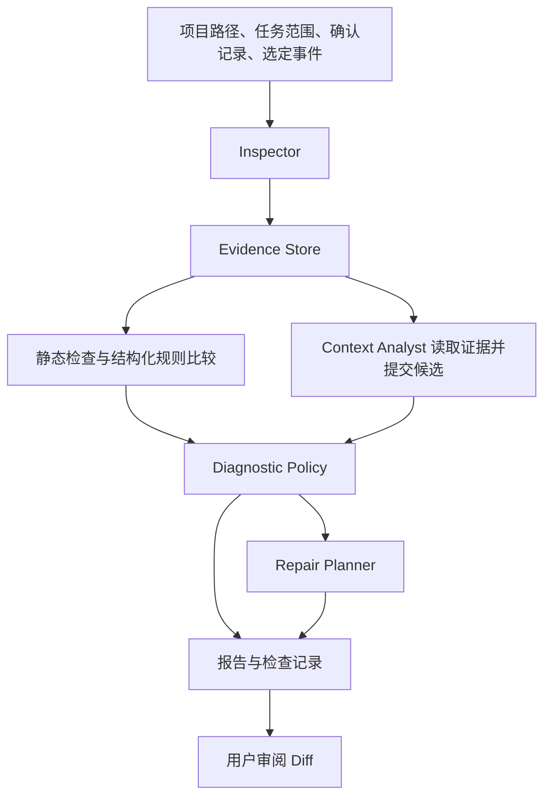

# Context Manager 详细方案

总体设计版本 `0.2`，跨功能接口以[契约 r2](contracts.md)和[接口矩阵](interfaces.md)为准。更新日期 `2026-11-04`。本文件描述待实现的软件。当前进度和实际测试结果统一记录在 [EXECUTION_PLAN.md](../EXECUTION_PLAN.md)。

## 1. 目标与使用方式

项目帮助长期使用 Coding Agent 的开发者维护可信的项目上下文。用户指定项目、当前任务范围及已经确认的需求，工具检查 `AGENTS.md`、`CLAUDE.md` 和相关决策，给出逐条可追溯的整理建议。用户遇到重复错误时，可以再提供选定的事件，追查规则内容、加载过程和执行行为。

首版有两个入口。

- `audit` 检查当前规则。输出保留、更新、删除、缩小范围、迁移或需要确认的建议。
- `diagnose` 在体检基础上关联事件，判断哪些错误独立发生过、当时适用什么规则、加载情况能否确认，以及修复应落在哪里。

首版交付检查报告和修复 Diff。实际应用 Diff 属于人工审阅后的操作。自动应用、原生会话目录监听、跨 Agent 自动同步、Hook 自动安装列入后续阶段。

## 2. 产品验收目标

| 目标 | 用户可以观察到的结果 | 实现与验收单元 |
| --- | --- | --- |
| 找出过时规则 | 指出原文行段、已生效的新决策和冲突范围，保留迁移例外 | F03、F04、F06、F07 |
| 找出矛盾与重复材料 | 区分同范围冲突、不同范围的合法差异、历史引用与可迁移内容 | F04、F06、F07 |
| 追查重复错误 | 按独立任务统计违规，并展示版本、加载记录、支持与反证 | F05、F07 |
| 给出正确的修复方向 | 规则过时更新规则，加载缺失修发现路径，已加载后违背建议可执行检查，材料不足则给出缺口 | F07、F08 |
| 预览最小修改 | Diff 只覆盖已明确的规则条款，保留独立义务及兼容目录规则 | F08 |
| 结果可复核 | 引用能回到同一快照的原文，报告明确哪些检查已执行、失败或未执行 | F02、F09、F10 |

当前代码描述实际实现，已确认的需求与决策描述应该实现什么。发生冲突时，报告应同时呈现两者。文件更新时间只用于追踪，决定替代关系需要明确的授权、生效时间、范围和 `supersedes`。

## 3. 运行架构

系统运行时包含 **1 个语义分析 Agent 和 4 个程序模块**。用户要求的逐功能实现、开发子 Agent 和本聊天的审查者属于开发协作角色，与产品运行时数量分别记录。

| 组件 | 执行方式 | 责任 |
| --- | --- | --- |
| Inspector | Python | 发现候选指令及依赖，检查路径、命令引用和预计作用范围 |
| Evidence Store | Python | 捕获并索引原文、行段、文件摘要、事件和读取覆盖 |
| Context Analyst | 单 Agent 的有界工具循环 | 理解自然语言，提出规则对齐、冲突、例外、根因与改写候选 |
| Diagnostic Policy | Python | 校验结构、引用、决策授权和时间范围，核对加载证据、去重与结论门槛 |
| Repair Planner | Python | 把有明确依据的编辑意图转换为限定范围的 Diff，检查基准与可应用性 |

CLI、模型传输和报告渲染是接口代码，使用上述组件的结构化结果。

基础模式仅运行程序检查。语义模式显式使用本地模型，Agent 可以分多轮阅读当前运行的证据。两种模式的覆盖记录必须说明语义分析是否执行。基础模式下，任意自然语言的含义仍可能待确认。

## 4. 数据与判断边界

输入分为项目材料、用户明确纳入的决策登记、用户选定的合成事件及本机运行配置。所有具体字段、ID 关系、范围和结论枚举以 [数据契约](contracts.md) 为准。

规则片段由程序按 Markdown 结构定位。自由文本含义由 Agent 提取，或由用户提供结构化确认。代码能比较结构化的相同主题和值，并检查证据来源和生效范围。程序核验引用存在后，语义解释仍保持其原有的确认级别。

针对每次历史动作，使用当时可确认的规则版本、任务范围与生效决策。当前工作树的内容可以支持当前体检。历史材料缺失时，历史加载或成因结论标为未知。

| 结论 | 必要依据 | 修复方向 |
| --- | --- | --- |
| 当前规则过时 | 同范围内已确认生效且明确替代旧约束的决策 | 更新或删除具体条款 |
| 当前规则冲突 | 条件和范围重叠，约束不能同时满足 | 限定范围或确认权威来源 |
| 应用时未加载 | 规则应适用，动作前存在完整且版本可对应的上下文清单 | 修发现、导入或注入 |
| 已加载后行为违背 | 正确规则的内容或覆盖证明进入对应动作前的上下文，行为违反适用条款 | 提议 Hook、Lint 或测试 |
| 使用旧代码证据 | 动作所引用代码的快照与任务要求版本可对照 | 修检索和版本选择 |
| 无法判断 | 任务范围、决策、快照、动作或回执不足 | 列出具体待补材料 |

同一问题允许存在多个发现。例如当前规则确实过时，而第二次错误的历史成因未知。根因描述保持“可能影响”的解释强度，证据支持的是可观察的规则、加载和行为事实。

## 5. 功能拆分

每份功能规格包含入口、输入输出、实现职责、异常处理、本地测试和审查条件。按下表顺序逐项实现。

| ID | 功能 | 主要依赖 | 规格 |
| --- | --- | --- | --- |
| F01 | 工程入口与公共契约 | 无 | [F01](features/F01-foundation.md) |
| F02 | 证据快照与受限读取 | F01 | [F02](features/F02-evidence.md) |
| F03 | 指令发现、作用范围与静态引用检查 | F02 | [F03](features/F03-inspection.md) |
| F04 | 规则与决策登记、静态冲突判定 | F02、F03 | [F04](features/F04-rules-decisions.md) |
| F05 | 合成事件、加载回执与复发统计 | F02、F04 | [F05](features/F05-incidents.md) |
| F06 | 单 Agent 本地语义分析 | F02、F04、F05 | [F06](features/F06-analyst.md) |
| F07 | 证据核验与诊断结论 | F03–F06 | [F07](features/F07-diagnosis.md) |
| F08 | 最小修复提案与 Diff 预检 | F04、F07 | [F08](features/F08-repair.md) |
| F09 | 报告、覆盖率与运行产物 | F02、F07、F08 | [F09](features/F09-reporting.md) |
| F10 | CLI 串联、本地集成与最终交付 | F01–F09 | [F10](features/F10-integration.md) |

文件布局建议使用 `src/context_manager/` 和 `tests/`。每个功能的建议文件在规格中给出，实施时可按代码复用需要微调，并在执行记录中说明。共享数据契约的变更先更新设计和影响范围，再改相关功能。

## 6. 本地测试方式

设计选用 Python 3.11+ 和 `pytest`。实现者在 IDE 的测试窗口或终端运行同一组测试。实际执行结果、退出码与当前源文件摘要共同构成验收依据。`compileall` 只负责语法检查，功能是否通过由断言和实际 CLI 行为确认。

项目测试使用临时目录中的合成仓库和事件。静态规则测试及 Agent 工具循环测试在本地执行。语义能力另用本地模型实际运行，结果保留模型标识、参数、输入摘要与失败案例。测试替身用于覆盖异常协议、工具边界和预算，不作为模型语义能力的验收结果。

远程推理、在线预测、GitHub Actions 和付费服务不进入首版验收流程。测试环境需要的依赖在开发前准备好，测试阶段可断开外网。本地模型只接收合成材料，真实日志接入延后。

执行命令、通过条件和复核流程见 [本地验收规范](acceptance.md)。目前测试文件与 CLI 待实现，文档中的命令是实施目标。

## 7. 开发和审查顺序

每个设计组负责一项功能，可并行细化现有规格。实现者按确认后的规格编写代码，正式验收按依赖推进。代码和本地测试完成后逐功能交接，由本聊天对照实际代码、测试和规格复核，并在全部功能通过后统一汇总。见 [功能设计分工](agent-assignments.md)。

每项先完成本地验证，最终将全部功能一起提交。功能间的交接由执行记录和源文件摘要标识。当前仓库没有提交，最终交付时需复核远端状态。空远端采用一次初始提交发布，已有 `main` 则在完整复核后进行统一合并。具体操作安排在 F10。

本轮交付设计与执行记录。后续审查由新的代码和交接记录触发，审查结论写回同一状态文件。

## 8. 范围外的后续能力

后续阶段接入用户选定的原生 Codex、Claude Code 会话，并按各版本记录适配覆盖。之后再设计自动应用、真实行为重放、定时扫描、Hooks 安装和跨工具同步。用户许可、运行成本和具体效果在对应阶段独立确认。

同类项目及源码依据保存在 [调研记录](landscape.md)。本设计借鉴代码承担机械检查、模型承担语义判断的分工，具体诊断门槛和交付流程按本项目目标制定。
